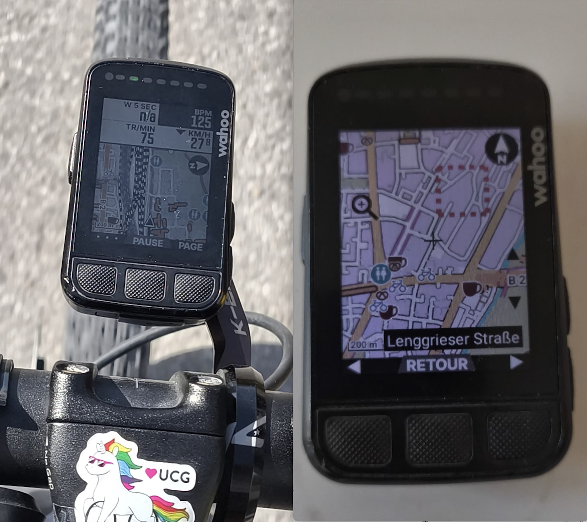
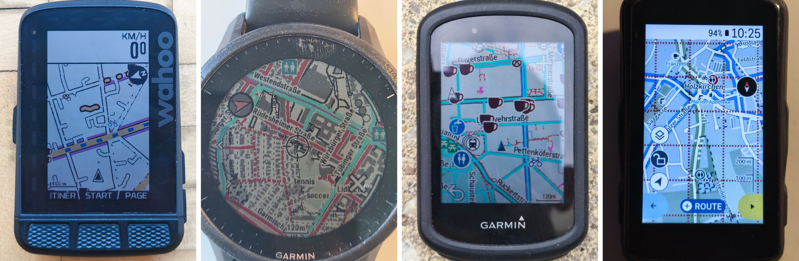
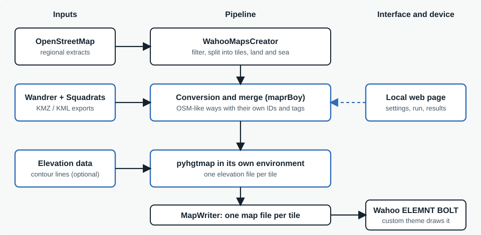
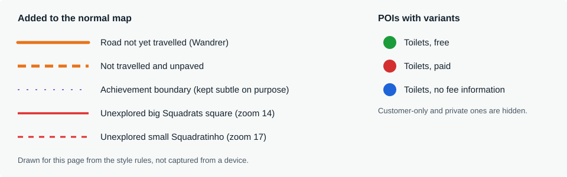
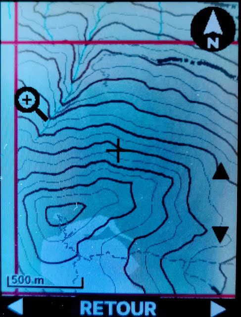
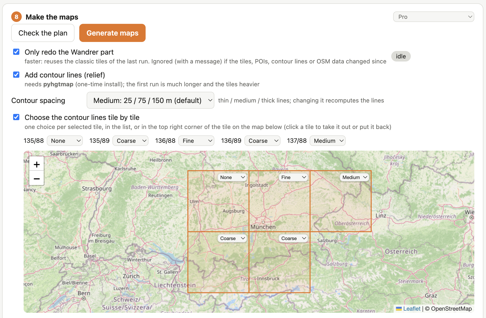
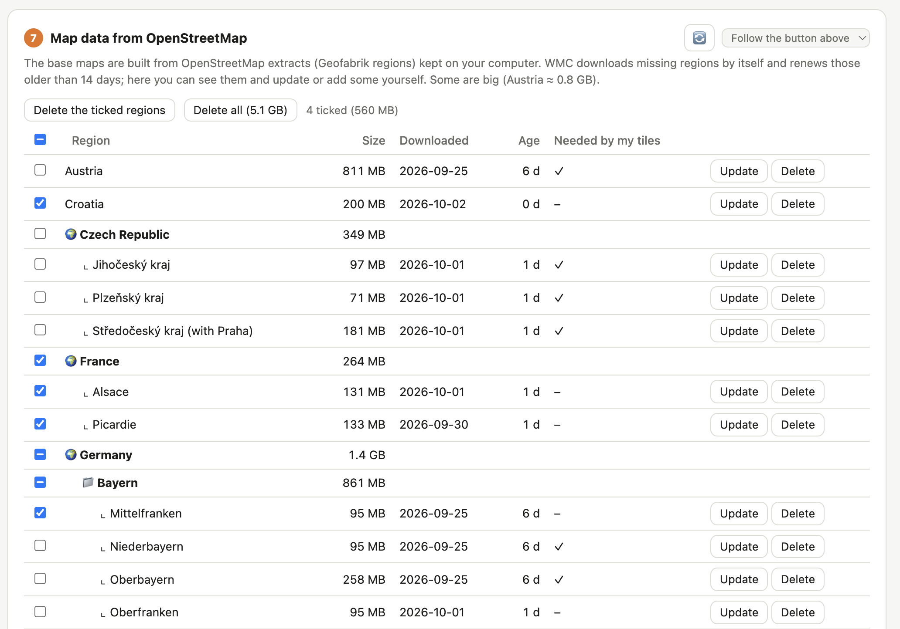

## The problem

[Wandrer.earth](https://wandrer.earth) tracks which roads you have cycled and gives you maps with the roads you have not yet ridden highlighted. I have used those maps for years, and they come with a trade-off: either the very plain Wandrer map style, or the colours and detail of the device's own maps. [WahooMapsCreator](https://github.com/treee111/wahooMapsCreator) (WMC) builds far prettier and more detailed maps for Wahoo devices, with points of interest, but it knows nothing about my Wandrer history.

What I wanted was both at once: a detailed map where, at a glance, I can see which roads are still unexplored, and where the squares of the Squadrats game I have not yet visited are outlined too. It started with my Wahoo BOLT v2, which shows one map only, so the extra information has to be inside the map file. Then came my Garmin watch, borrowed Garmin and Hammerhead bike computers, and people who wanted to try it.

<figure>
  
  <figcaption>The BOLT v2 screen showing orange unvisited roads mid-ride and the Squadrats dashed outlines.</figcaption>
</figure>

## One source, three map formats

The first decision shaped everything after it: Wandrer data stays an independent geometry. It is never matched with OpenStreetMap roads, which may come from another snapshot, split, merged or re-tagged. Wandrer lines are simply extra ways with their own IDs and tags, drawn on top of the roads. I also looked at Wandrer's own vector tiles and dropped them: the endpoints are internal and authenticated, and my own KMZ export is a simpler and explicit source.

That choice is what made other devices possible. The same Wandrer and Squadrats lines go into three very different formats:

- **Wahoo**: one mapsforge file per zoom-8 tile (about 100 km wide in central Europe), built by WMC, with my layers merged in and drawn by a VTM theme on the device. The ROAM v1 reads the same maps gzip-compressed, and needs a switch file to use the theme.
- **Garmin**: a transparent overlay made with mkgmap, with its own colours compiled into a TYP file, drawn over the Garmin map; and, optionally, an OpenStreetMap base map with my points of interest replacing Garmin's.
- **Hammerhead Karoo**: one mapsforge `.map` file for the chosen area, drawn over Hammerhead's own maps, with my rules added at the end of the device's theme.

<figure>
  
  <figcaption>The same layers on four devices: Wahoo ROAM v1, Garmin Forerunner 955, Garmin Edge 830 and Hammerhead Karoo 2.</figcaption>
</figure>

<figure>
  
  <figcaption>The Wahoo pipeline. Garmin and Karoo work the same way without WMC: Osmium extracts what is needed, then mkgmap or the mapsforge writer make the map.</figcaption>
</figure>

## What it does

- Reads several Wandrer exports and merges them: where two exports overlap, the newest wins. Only the unvisited roads near roads I have ridden are kept, so maps stay light.
- Outlines the Squadrats squares I have not explored, in two sizes.
- Adds the points of interest I use on the road, with icons that change with the data (free or paid toilets, for example).
- On the Wahoo, adds contour lines, with a level of detail chosen for each tile.
- Lets me choose the area as zoom-8 tiles (Wahoo) or a rectangle drawn on the map (Garmin, Karoo), and names each map after the biggest town inside it, found in the OpenStreetMap data.
- Downloads and manages the OpenStreetMap regions it needs: date, size, age, update or delete.
- Copies the maps to the device plugged in by USB, and restarts it when the device needs that to read them.
- Does all of it from a local web page, with a Simple and a Pro mode.

<figure>
  
  <figcaption>What the extra layers look like on the BOLT.</figcaption>
</figure>

## Decisions worth explaining

### Three places for every tag, or it silently disappears

On the Wahoo, a custom tag has to be declared in three places: the tag mapping that tells the map writer what to encode, the list of tags the Osmium filter keeps, and the theme that draws it. Miss one and nothing fails: the data simply never reaches the map. The first time I added the Squadrats layer, the layer vanished without a single error; the only symptom was tile files whose size did not change. The rule since: check the data before the style. Today the points of interest come from one table (tag, condition, icon, zoom), from which the three places are generated.

### Squadrats as integer arithmetic

A [Squadrats](https://squadrats.com) square matches the boundaries of an ordinary OpenStreetMap web tile, so everything is computed with integer tile indices, with no geometric error. The export holds the explored squares, dissolved into polygons with holes; the tool rebuilds them exactly (the counts match) and outlines the unexplored ones, each edge drawn once.

### Designing for screens, not for my desk

Every device draws differently. On the BOLT, line widths do not follow the zoom level, so styles are a compromise tested at the scales I really use. On a Garmin, the overlay only shows with the "Classic" map theme: with "High Contrast" my lines turned grey and Wandrer's own overlays vanished. On the watch, orange was too close to Garmin's roads and red to the track drawn during an activity, hence cyan for the roads not yet ridden. Maps copied into `Garmin/CustomMaps` were never read; in `Garmin/` they were. None of this is in a specification: each one came from a device in my hand.

### Contour lines, and the cost of detail

Contour lines come from free elevation data and pyhgtmap. They are the heaviest feature: a tile with 10 m contour lines was 25 to 34 MB on the two tiles I tested, against 16 to 19 MB for a tile from Wahoo. So the spacing is a choice of three presets, in which the medium and thick lines always fall on an existing thin one, and it can be chosen tile by tile, because a flat tile around Munich and an Alpine tile do not need the same detail.

<figure>
  
  <figcaption style="text-align:center">Contour lines on the BOLT v2, at the 500 m scale.</figcaption>
</figure>

<figure>
  
  <figcaption>Test build with synthetic tiles: the contour level chosen tile by tile.</figcaption>
</figure>

### A web page instead of a desktop window

A map you can click to choose an area is much simpler in a browser, so the interface is a small local web page (a Python server and a Leaflet map) that only listens on the computer itself. Simple mode hides what most people do not need; Pro mode unlocks the details. The page only builds command lines for the scripts, so every option exists in the command line first, with a default. Long builds are safe to run: a run replaces only the tiles it rebuilds, can be stopped at any time, and tells which step failed and, for known causes, what to do.

<figure>
  
  <figcaption>The downloaded OpenStreetMap regions, grouped by country.</figcaption>
</figure>

### From my computer to other people's

Giving the tool to others meant hiding the installation that kept me away from WMC for years. One command, pasted in a terminal, downloads a self-contained environment (Python, GDAL, Osmium, Java) from conda-forge with micromamba, plus Osmosis, mkgmap and adb, into one folder for the application and one for the data; an uninstaller removes it all. It was tested on an Intel Mac with macOS 10.14, an Apple Silicon Mac, Windows 10 and Windows 11.

Each new machine found something my own never had: a Windows virtual machine where a background adb server kept the program folder locked, an antivirus asking about the elevation data download, a first user who typed a command where the installer expected a folder name, a map of Brittany whose west longitude (a leading minus sign) was read as a new option. The data side had its own surprise: the server of the coastline polygons was down for hours, and WMC deletes its old copy before downloading a new one. maprBoy now keeps its copy for six months, replaces it only once a new one is complete, and falls back on a copy published with the repository.

### Respecting the data and the licences

Wandrer and Squadrats exports are personal, so the repository never contains them, nor any generated map. WMC is used as a pinned dependency, not copied or modified. OpenStreetMap data is under the ODbL and WMC is GPL-3, so maprBoy is published under GPL-3.0 too.

## How I tested it

Most of the testing happens on the devices themselves: copy a map, look at it on the road, at the scale I really use. I tested on my BOLT v2 and Forerunner 955, and on a ROAM v1, an Edge 830, an Edge 530 and a Karoo 2 lent by other riders. The code has about 260 automated tests, on synthetic data only. The installers were tested on four systems, two of them by first users on their own computers.

## What I learned

**Silent failures are the worst kind.** A layer that disappears without an error cost me more time than any crash. Since then I check the data before touching the style, and I make scripts say out loud what they skipped.

**A device is part of the design.** Line widths that do not scale, map themes that hide an overlay, folders a device does not read: none of it appears on a screen at my desk.

**Keep the data independent of its destination.** Because the Wandrer lines were never tied to one map format, adding Garmin and Karoo meant new writers, not a new pipeline.

**Every new computer is a new test.** The installer worked on mine long before it worked on a virtual machine, a friend's Mac and my brother's PC.

**How I worked.** I built this with an AI assistant. I set the goals, made the data and design decisions, tested each result on the devices, and decided what stayed. The assistant did most of the typing, and explained things to me along the way, which is how I learned the map-building tools.

## What comes next

- Ride with the Garmin maps: line widths and icon size outdoors, and points of interest shown twice next to Garmin's own.
- Gather the feedback of the first users, and simplify the page where they hesitate.
- Contour lines for Garmin and Karoo.
- If Squadrats ever stopped being free: VeloViewer and StatsHunter exports use the same grid, so they could replace it, without the small squares.
